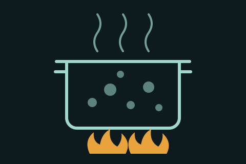

> **Warnung: Nicht gegen Chemikalien**
> Abkochen tötet Keime, entfernt aber keinen Kraftstoff, kein Salz, keine Metalle und keine anderen Chemikalien. Wasser, das nach Kraftstoff oder Chemikalien riecht, nicht verwenden.

## Abbildungen

1. 

## Du brauchst

- Ein sauberer Topf, am besten mit Deckel
- Eine Wärmequelle
- Saubere Behälter mit Deckel zum Aufbewahren

## Schritte

1. **Erst klären** Ist das Wasser trüb, lass es sich absetzen und gieße es vor dem Kochen durch ein sauberes Tuch.
2. **Sprudelnd aufkochen** Erhitze, bis ständig große Blasen aufsteigen, und lass es dann 1 Minute kochen. Über 2.000 m: 3 Minuten.
3. **Abgedeckt abkühlen** Lass das Wasser mit Deckel von selbst abkühlen. Kein Eis hineingeben.
4. **Sauber aufbewahren** Fülle es in saubere Behälter mit Deckel und lagere es kühl und dunkel.

## Prüfen

- Während der ganzen Kochzeit stiegen große Blasen auf.
- Das Wasser war vor dem Kochen klar.

## Häufige Fehler

- Bei den ersten kleinen Blasen aufhören.
- Offen oder mit Eis unbekannter Herkunft abkühlen.
- In einem nicht sauberen Behälter aufbewahren.

## Weiterführend

1. Kochzeiten, auch in großer Höhe
