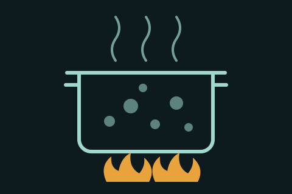

> **Warning: Not for chemicals**
> Boiling kills germs but does not remove fuel, salt, metals or other chemicals. Don't use water that smells of fuel or chemicals.

## Figures

1. 

## You need

- A clean pot, ideally with a lid
- A heat source
- Clean containers with lids for storage

## Steps

1. **Clear it first** If the water is cloudy, let it settle and pour it through a clean cloth before boiling.
2. **Bring to a rolling boil** Heat until large bubbles rise steadily, then keep it boiling for 1 minute. Above 2,000 m, boil for 3 minutes.
3. **Cool it covered** Let the water cool by itself with the lid on. Don't add ice.
4. **Store it clean** Pour it into clean containers with lids and keep it in a cool, dark place.

## Check

- Large bubbles kept rising for the whole boiling time.
- The water was clear before boiling.

## Common mistakes

- Stopping at the first small bubbles.
- Cooling it uncovered or with ice from an unknown source.
- Storing it in a container that wasn't clean.

## Further reading

1. Boiling times, including at altitude
